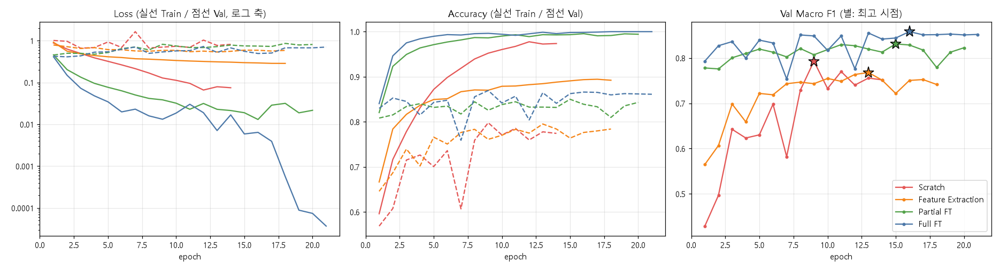
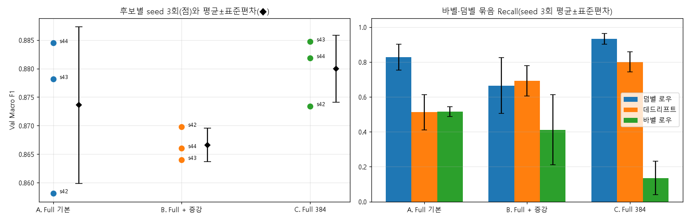
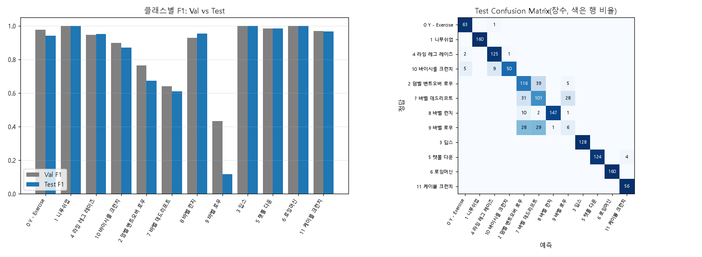

# 피트니스 이미지 기반 운동 종류 분류 (ResNet18 Scratch vs Transfer Learning)

헬스장 카메라로 찍은 사진 한 장을 보고 12가지 운동 중 무엇인지 맞히는 분류기입니다. 같은 ResNet18로 처음부터 학습(Scratch)한 경우와 ImageNet 사전학습 가중치를 가져와 학습(Transfer Learning)한 경우를 같은 분할·같은 기준으로 비교했습니다.

전체를 미세조정하는 **Full Fine-tuning이 Validation Macro F1 0.858로 가장 좋았고, Scratch는 0.793**이었습니다. seed 3개 반복으로 최종 모델을 고른 뒤 처음 보는 사람 3명으로 구성된 Test에서 한 번 평가해 **Macro F1 0.839, Accuracy 0.863**을 얻었습니다. 오답은 모두 비슷한 운동끼리(특히 덤벨 로우·데드리프트·바벨 로우) 섞인 것이었습니다.

> 초안입니다(2026-11-26). VLM 분석과 전처리 방식 비교 시리즈는 아직 하지 않았습니다.

## 1. 프로젝트 개요

- **해결하려던 문제:** 사진 한 장에서 사람이 어떤 운동을 하는지 분류합니다. 자세가 올바른지, 부상 위험이 있는지는 판정하지 않습니다.
- **목표와 평가 기준**
  - 핵심 지표는 **Macro F1**(12클래스 F1의 단순 평균)입니다. 클래스 장수 차이가 3.6배라서 Accuracy만 보면 장수 많은 운동이 결과를 좌우합니다. 그래서 장수가 적은 운동(바벨 로우, Y-Exercise 등)을 놓치는 것을 "중요한 오류"로 보았습니다.
  - 보조 지표는 Accuracy, 클래스별 Precision·Recall·F1, Confusion Matrix, 학습 시간, GPU 메모리입니다.
  - 모델·하이퍼파라미터는 Validation으로만 골랐습니다. Test는 최종 모델을 정한 뒤 **한 번만** 썼습니다.

| 항목 | 내용 |
|---|---|
| 기간 | 2026.11.26 ~ 2026.12.07 |
| 사용 데이터 | AI Hub [피트니스 자세 이미지](https://www.aihub.or.kr/aihubdata/data/view.do?dataSetSn=231)의 원본 Validation에서 골라, 사람 코드 기준으로 다시 나눈 교육용 분할(`fitness_dataset.zip`). 원본 공식 벤치마크와 다릅니다 |
| 분할 | Train 8,144장 / Val 1,440장 / Test 1,432장. 같은 사람의 이미지는 한 분할에만 있습니다(사람·클립 단위 누수 없음 확인) |
| 주요 기술 | Python 3.14, PyTorch 2.14(CUDA 13.0), torchvision ResNet18, scikit-learn, pandas, matplotlib, uv |
| 실행 환경 | Windows 11, NVIDIA GeForce RTX 5060 Laptop GPU 8GB |

## 2. 프로젝트 구조

```text
fitness/
├── README.md
├── EXPERIMENTS.md          # 실험마다 한 줄 기록(실패한 실험 포함)
├── pyproject.toml / uv.lock / .python-version / .gitignore
├── data/raw/               # 데이터(저장소에 없음, 아래 3절 참고)
├── src/
│   ├── common.py           # 경로, 클래스 이름, 운동 묶음
│   ├── dataset.py          # letterbox 전처리, Dataset·DataLoader, 증강, 재현성 설정
│   ├── models.py           # ResNet18 네 전략(scratch/fe/partial/full)
│   ├── trainer.py          # 학습 루프(AMP, Early Stopping, 최고 시점 복원)
│   ├── metrics.py          # Macro F1(12클래스 고정), Accuracy, 클래스별 지표, CM
│   ├── run_experiment.py   # 실험 실행 CLI(설정을 학습 전에 저장)
│   ├── predict.py          # 저장한 가중치로 이미지별 예측(Test는 명시해야만)
│   └── run_test_once.py    # 최종 Test 1회 평가
├── checks/                 # 데이터 무결성 검사, 파이프라인 자체 점검(58항목)과 그 출력
├── notebooks/              # 01~09 분석 노트북(아래 표)
├── experiments/            # 실행별 config.json, history.csv, summary.json, 계획(PLAN.md), 로그
├── figures/                # 결과 그림
└── models/                 # 학습한 가중치(저장소에 없음)
```

## 3. 설치 및 실행 방법

### 환경 설치

```bash
git clone https://github.com/Peter-jackson12/Fitness.git
cd Fitness
uv sync
```

- Windows·Linux에서는 PyTorch CUDA 13.0 빌드를 받습니다(`pyproject.toml`의 `pytorch-cu130` 인덱스).
- VS Code에서 노트북을 열고 **Select Kernel**에서 프로젝트 `.venv`를 고릅니다.

### 데이터 준비

1. 교육 과정에서 배포한 `fitness_dataset.zip`을 받아 `data/raw/`에 풉니다. `data/raw/metadata.csv`, `data/raw/metadata_train_{25,50,100}pct.csv`, `data/raw/images/`가 생기면 됩니다.
2. 원본 이미지는 AI Hub 이용 조건 때문에 이 저장소에 넣지 않았습니다. 노트북에서 원본 사진을 그리는 셀의 출력도 지웠습니다. 로컬에서 실행하면 `figures/samples/`에 저장됩니다.

### 실행 순서

| 순서 | 파일 | 내용 |
|---|---|---|
| 1 | `notebooks/01_eda.ipynb` | 문제 정의, 클래스·사람·카메라 분포, 평균 이미지, 화질, ImageNet 모델로 본 데이터 |
| 2 | `notebooks/02_preprocessing.ipynb` | letterbox 전처리, 분할·누수 확인, DataLoader, 1 epoch 시간 측정(E00) |
| 3 | `notebooks/03_baseline_comparison.ipynb` | 네 전략 기본 학습 비교(E01~E04) |
| 4 | `notebooks/04_tuning.ipynb` | 튜닝 1·2차(E05) |
| 5 | `notebooks/05_error_analysis.ipynb` | Validation 오류 분석(E06) |
| 6 | `notebooks/06_resolution.ipynb` | 개선 실험 1: 입력 해상도 384(E07a·b) |
| 7 | `notebooks/07_class_weight.ipynb` | 개선 실험 2: 클래스 가중치(E07c·d) |
| 8 | `notebooks/08_selection.ipynb` | 최종 후보 seed 반복과 선정 |
| 9 | `notebooks/09_test_evaluation.ipynb` | 최종 Test 1회 결과(저장된 결과만 읽음) |

학습은 CLI로 돌렸고, 노트북은 저장된 결과를 읽어 분석합니다.

```bash
uv run python src/run_experiment.py --run-id E04 --strategies full --max-epochs 50
```

## 4. 수행 내역

| 작업 구분 | 직접 수행한 작업 | 근거 자료 |
|---|---|---|
| 문제 정의·EDA | Macro F1을 핵심 지표로 정함. 배경이 운동 묶음(맨몸 바닥 / 선 자세 바벨·덤벨 / 기구)을 알려 준다는 것을 평균 이미지 유사도로 확인(같은 묶음 0.964, 다른 묶음 0.206). 그래서 묶음 안 구분이 핵심 난이도라고 봄 | `01_eda.ipynb` |
| 분할·누수 점검 | 공식 수치(장수·사람·클립)와 일치, 사람·클립·이미지가 분할 사이에 겹치지 않음(0건), 파일 대응·디코딩·중복 확인 | `checks/check_data_integrity.py`, `checks/check_data_integrity.out.txt` |
| 전처리 | 384×216 원본을 비율 유지로 224×224에 맞춤(letterbox, ImageNet 평균색 패딩) | `src/dataset.py` |
| 학습 파이프라인 | 네 전략, AMP, Early Stopping(Val Macro F1, patience 5), 결정적 모드 재현성, 실행 ID 잠금·덮어쓰기 방지. 학습 전에 58개 항목 자체 점검(Val 증강 없음, BN 고정, lr 그룹, Macro F1 계산 등) | `src/`, `checks/check_pipeline.py` |
| 비교·튜닝·개선 | 기본 4전략, 튜닝 6회, 개선 4회, seed 반복 6회. 판정 기준(±0.02)은 항상 실행 전에 `PLAN.md`에 적음 | `EXPERIMENTS.md`, `experiments/*/PLAN.md` |
| 오류 분석 | 오답이 클래스 × 카메라 칸에 몰림을 확인. 데드리프트의 선 자세(lockout)는 뒤·정면에서 바벨 로우와 구분이 어려움 | `05_error_analysis.ipynb` |
| 최종 선정·Test | 후보 3개 × seed 3개, 미리 정한 규칙으로 선정. Test 1회 | `08_selection.ipynb`, `09_test_evaluation.ipynb` |
| 검증 | 다른 모델(Codex)의 읽기 전용 독립 리뷰 2회(학습·평가 코드, 최종 결과 정합성). 지적 사항(재현성, 결과 덮어쓰기, 평가 때 불필요한 가중치 다운로드, 해석 문구 오류 등)을 고친 뒤 다시 확인 | — |

## 5. 문제 해결 과정

### 주요 접근

- **같은 조건 비교:** 네 전략 모두 같은 분할, 같은 전처리, 같은 옵티마이저(AdamW, 새 분류기 lr 1e-3 / 사전학습 층 lr 1e-4), 같은 Early Stopping을 씁니다. 새 분류기(`fc`)의 초기값도 seed로 같게 맞췄습니다.
- **재현성:** cuDNN 결정적 모드와 `torch.use_deterministic_algorithms(True)`를 기본으로 켰습니다. 같은 실행을 별도 프로세스로 두 번 돌려 Val Macro F1과 가중치 해시가 같음을 확인했습니다(끄면 달라짐).
- **판정 기준을 먼저 적기:** 튜닝·개선 실험은 "Val Macro F1이 +0.02 이상이면 개선"을 실행 전에 적고 판정했습니다. 결과를 보고 기준을 바꾸지 않았습니다.

### 중요한 문제와 판단

**1. 개선처럼 보인 차이가 seed 운이었다**

- **문제·관찰:** 증강(+0.012)과 해상도 384(+0.015)가 기본보다 조금 좋아 보였습니다. 그러나 둘 다 기준(+0.02)에 못 미쳤고, 바꿀 때마다 덤벨 로우·데드리프트·바벨 로우 중 하나가 좋아지면 다른 하나가 나빠졌습니다.
- **판단 근거:** 단일 실행 0.01 차이로 최종 모델을 고르면 우연을 고를 수 있다고 봤습니다.
- **수행한 작업:** 후보 3개(Full 기본, Full+증강, Full 384)를 seed 3개씩 반복했습니다. 선정 규칙(클래스 붕괴 제외 → 평균 → 구분 불가면 단순한 쪽 → 가운데 seed 가중치)은 결과를 보기 전에 정했습니다.
- **판단의 변화:** seed만 바꿔도 같은 조건의 점수가 0.858~0.884로 움직였습니다. 처음의 기본 실행이 세 번 중 가장 나쁜 실행이었습니다. 384는 평균이 가장 높았지만 seed 3번 중 2번 바벨 로우를 거의 못 맞혀 제외했습니다. Full 기본과 Full+증강은 구분할 수 없어 더 단순한 Full 기본을 골랐습니다.

**2. 클래스 가중치는 구분을 돕지 않고 "애매하면 어느 쪽"만 바꿨다**

- **문제·관찰:** 가장 적은 바벨 로우(Train 312장)가 여러 실행에서 통째로 사라졌습니다.
- **수행한 작업:** 학습 손실에 클래스 가중치(N/(K·n_c))를 줬습니다.
- **판단의 변화:** 바벨 로우 Recall은 0.53 → 0.72로 올랐지만 바벨 로우라고 답한 사진이 138장 → 201장으로 늘었습니다. Precision은 오히려 떨어졌고 Macro F1은 −0.021이었습니다. 모델이 세 운동을 더 잘 구분하게 된 것이 아니라 애매한 사진의 기본값만 바뀐 것이라 채택하지 않았습니다.

## 6. 주요 실험 및 결과

### 학습 전략 비교(기본 학습, Validation)

모두 Train 100%(8,144장), letterbox 224, Batch 32, AdamW, AMP fp16, 최대 50 epoch, Early Stopping patience 5, seed 42, RTX 5060 Laptop에서 실행했습니다. 학습 시간은 실행 한 번의 전체 시간입니다.

| 비교 항목 | Scratch | Feature Extraction | Partial FT | **Full FT** |
|---|---|---|---|---|
| 초기 가중치 | 무작위 | ImageNet | ImageNet | ImageNet |
| 학습 범위 | 전체 | `fc`만 | `layer4` + `fc` | 전체 |
| 전체 파라미터 수 | 11,182,668 | 11,182,668 | 11,182,668 | 11,182,668 |
| 학습 가능 파라미터 수 | 11,182,668 | 6,156 | 8,399,884 | 11,182,668 |
| 최고 / 멈춘 epoch | 9 / 14 | 13 / 18 | 15 / 20 | 16 / 21 |
| 학습 시간 | 3.0분 | 2.7분 | 3.1분 | 4.4분 |
| 최대 GPU 메모리 | 629MB | 242MB | 339MB | 629MB |
| Validation Macro F1 | 0.793 | 0.768 | 0.831 | **0.858** |
| Validation Accuracy | 0.798 | 0.795 | 0.850 | **0.866** |

- 사전학습 가중치를 쓰고, 많은 층을 학습할수록 좋았습니다(Full > Partial). 헬스장 사진은 ImageNet과 많이 달라서, 사전학습 특징을 고정해 두는 FE는 Scratch보다도 낮았습니다(과소적합).

### 주요 실험 및 개선 결과(Validation Macro F1)

| 시도 | 변경 내용 | 결과 | 결정 |
|---|---|---|---|
| Scratch 기본(E01) | — | 0.793 | 기준 |
| Scratch 튜닝(E05a·e) | 증강 / 증강 + patience 10 | 0.713 / 0.779 | 채택 안 함 |
| FE 튜닝(E05b) | 분류기 lr 1e-3 → 1e-2 | 0.735 | 채택 안 함 |
| Partial 튜닝(E05c) | 증강 | 0.814 | 채택 안 함 |
| Full 기본(E04) | — | 0.858 | 기준 |
| Full 튜닝(E05d·f) | 증강 / 증강 + patience 10 | 0.870 / 0.870 | 차이 없음(+0.012 < 0.02) |
| 개선 1: 해상도(E07a·b) | 입력 224 → 384(Full / Scratch) | 0.873 / 0.749 | Full은 차이 없음, 바벨 로우 Recall 0.03 |
| 개선 2: 클래스 가중치(E07c·d) | balanced 가중치(Full / Scratch) | 0.837 / 0.745 | 악화, 채택 안 함 |
| 최종 후보 seed 반복(SEL) | Full 기본 / +증강 / 384 × seed 42·43·44 | 0.874±0.014 / 0.867±0.003 / 0.880±0.006 | Full 기본 선정(384는 붕괴 2회로 제외) |

전체 기록은 [`EXPERIMENTS.md`](EXPERIMENTS.md)에 있습니다.

### 최종 결과 및 해석

- **최종 모델:** Full Fine-tuning, letterbox 224, 증강 없음, seed 43(후보의 가운데 seed) 가중치
- **Validation(선정에 사용):** Macro F1 0.878, Accuracy 0.887
- **Test(1회):** **Macro F1 0.839, Accuracy 0.863**(1,432장, 사람 Z24·Z59·Z83)
- **해석**
  - Test가 Val보다 0.040 낮았습니다. 그중 0.027이 바벨 로우 한 클래스에서 나왔습니다(Recall 0.48 → 0.09).
  - 나머지 운동은 대부분 Val과 비슷했습니다. 기구 운동 4종과 니푸쉬업은 처음 보는 사람에서도 거의 완벽했습니다.
  - **오답 196장이 모두 같은 묶음 안에서 나왔습니다.** 모델은 큰 범주는 사람과 상관없이 맞히지만, 선 자세 바벨·덤벨 운동 사이의 세부 구분에서 사람에 따라 흔들립니다.

### 주요 결과 시각화

#### 학습 곡선(기본 4전략)



Full과 Partial은 몇 epoch 만에 Val이 올라가고, Scratch는 출렁이며 천천히 오릅니다.

#### seed 반복 비교



seed만 바꿔도 Macro F1이 0.026 움직였습니다. 384 후보는 바벨 로우를 반복해서 놓쳤습니다.

#### 최종 Test



오답이 모두 대각선 근처의 같은 묶음 칸(덤벨 로우·데드리프트·바벨 로우, 바닥 운동끼리)에 있습니다.

## 7. 한계 및 배운 점

- **한계**
  - Val도 Test도 **운동마다 한 사람**입니다. 클래스 점수가 사실상 그 한 사람의 점수라, 사람에 따른 흔들림을 잴 수 없었습니다. 선정에 쓴 Val 점수가 Test보다 0.04 낙관적이었습니다.
  - 정지 사진 한 장으로는 데드리프트의 선 자세와 로우를 가르기 어려운 프레임이 있습니다.
  - VLM 분석과 다른 전처리 방식(늘려 맞추기, 가운데 자르기 등) 비교는 아직 하지 않았습니다.
- **배운 점**
  - 0.01 차이는 seed만 바꿔도 생깁니다. 비교하기 전에 같은 조건의 흔들림부터 재야 합니다.
  - 판정 기준을 실행 전에 적어 두니, "좋아 보이는" 결과를 채택하고 싶은 유혹을 막을 수 있었습니다.
  - Accuracy와 Macro F1이 반대로 움직이는 경우가 있습니다(384: Accuracy 0.919로 최고였지만 바벨 로우 붕괴).
- **다음 접근:** 사람 단위 교차검증으로 Val을 여러 사람으로 꾸리기, 같은 클립의 연속 프레임 함께 보기, 바벨 로우처럼 적고 경계가 불안정한 클래스의 데이터 늘리기.
