# 피트니스 이미지 기반 운동 종류 분류 (ResNet18 Scratch vs Transfer Learning)

헬스장 카메라로 찍은 사진 한 장을 보고 12가지 운동 중 무엇인지 맞히는 분류기입니다. 같은 ResNet18로 처음부터 학습(Scratch)한 경우와 ImageNet 사전학습 가중치를 가져와 학습(Transfer Learning)한 경우를 같은 분할·같은 기준으로 비교했습니다.

전체를 미세조정하는 **Full Fine-tuning이 Validation Macro F1 0.858로 가장 좋았고, Scratch는 0.793**이었습니다. seed 3개 반복으로 최종 모델을 고른 뒤 처음 보는 사람 3명으로 구성된 Test에서 한 번 평가해 **Macro F1 0.839, Accuracy 0.863**을 얻었습니다. 오답은 모두 비슷한 운동끼리(특히 덤벨 로우·데드리프트·바벨 로우) 섞인 것이었습니다.

Test 이후에는 Test를 다시 쓰지 않고 보충 실험을 했습니다. VLM으로 오답 사진을 분석하고, 공식 Val(운동마다 한 사람) 대신 **19명을 사람 단위 3-fold로 나눈 교차검증(CV)**으로 전처리를 다시 비교했습니다. 공식 Val에서 내린 전처리 판정 일부가 CV에서 뒤집혔습니다. CV 기준으로는 **비율 유지 384×216 입력(aspect384)과 늘려 맞추기(stretch)가 letterbox보다 나았습니다**(9쌍 평균 Δ +0.028, +0.014). 바벨 로우는 어느 방식에서도 가장 약한 클래스로 남았습니다.

> 공식 결과는 E08 Test(Full FT, letterbox)이고, 보충 실험 결과는 Test로 확인하지 않은 개선 방향입니다(7절 한계).

### 핵심 결과 한눈에 보기

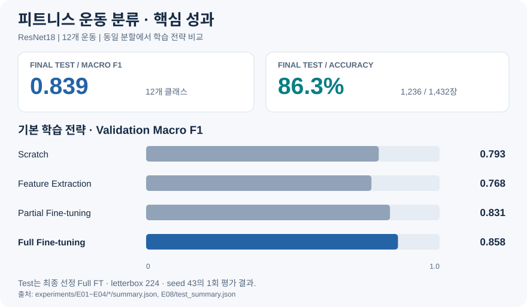

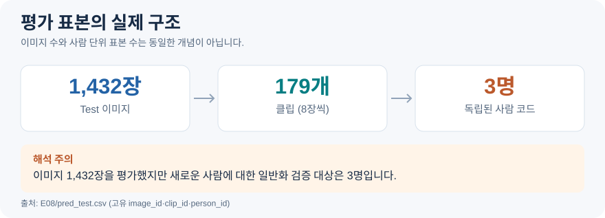

*수치 출처: E01~E04 및 E08 저장 결과. 이미지 단위 성능과 사람 단위 일반화의 범위를 구분합니다.*

## 1. 프로젝트 개요

- **해결하려던 문제:** 사진 한 장에서 사람이 어떤 운동을 하는지 분류합니다. 자세가 올바른지, 부상 위험이 있는지는 판정하지 않습니다.
- **목표와 평가 기준**
  - 핵심 지표는 **Macro F1**(12클래스 F1의 단순 평균)입니다. 클래스 장수 차이가 3.6배라서 Accuracy만 보면 장수 많은 운동이 결과를 좌우합니다. 그래서 장수가 적은 운동(바벨 로우, Y-Exercise 등)을 놓치는 것을 "중요한 오류"로 보았습니다.
  - 보조 지표는 Accuracy, 클래스별 Precision·Recall·F1, Confusion Matrix, 학습 시간, GPU 메모리입니다.
  - 모델·하이퍼파라미터는 Validation으로만 골랐습니다. Test는 최종 모델을 정한 뒤 **한 번만** 썼습니다.

| 항목 | 내용 |
|---|---|
| 기간 | 2026.11.26 ~ 2026.12.07 |
| 사용 데이터 | AI Hub [피트니스 자세 이미지](https://www.aihub.or.kr/aihubdata/data/view.do?dataSetSn=231)의 원본 Validation에서 골라, 사람 코드 기준으로 다시 나눈 교육용 분할(`fitness_dataset.zip`). 원본 공식 벤치마크와 다릅니다 |
| 분할 | Train 8,144장 / Val 1,440장 / Test 1,432장. 같은 사람의 이미지는 한 분할에만 있습니다(사람·클립 단위 누수 없음 확인) |
| 주요 기술 | Python 3.14, PyTorch 2.14(CUDA 13.0), torchvision ResNet18, scikit-learn, pandas, matplotlib, uv |
| 실행 환경 | Windows 11, NVIDIA GeForce RTX 5060 Laptop GPU 8GB |

### 분류 대상(12종)

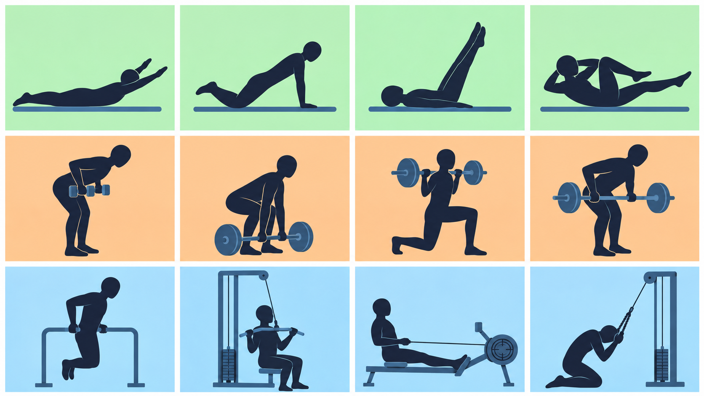

*AI로 만든 개념 그림이며 실제 데이터 사진이 아닙니다(원본 사진은 이용 조건 때문에 저장소에 넣지 않았습니다).*

| 줄 | 운동 묶음 | 운동(왼쪽부터) |
|---|---|---|
| 1 | 맨몸 바닥 운동 | Y-Exercise, 니푸쉬업, 라잉 레그 레이즈, 바이시클 크런치 |
| 2 | 선 자세 바벨·덤벨 | 덤벨 벤트오버 로우, 바벨 데드리프트, 바벨 런지, 바벨 로우 |
| 3 | 기구 운동 | 딥스, 랫풀다운, 로잉머신, 케이블 크런치 |

사람마다 대부분 한 묶음만 수행했고(Z84만 맨몸·기구 두 묶음), 묶음마다 촬영 공간이 다릅니다. 그래서 묶음끼리는 배경만으로도 구분되고, 어려운 것은 같은 묶음 안의 구분입니다(특히 2줄의 덤벨 로우·데드리프트·바벨 로우).

### 데이터 구성: 클립

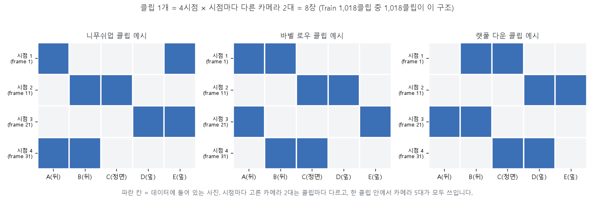

클립 하나는 한 사람이 한 운동을 한 번 수행한 장면을 카메라 5대(A~E)로 동시에 찍은 것입니다. 그중 4개 시점에서 시점마다 다른 카메라 2대의 사진을 골라 8장이 됩니다(Train 1,018클립 모두 같은 구조). 같은 순간을 다른 각도에서 찍은 사진이 한 클립에 들어 있으므로, 8장은 서로 독립된 표본이 아닙니다. 그래서 분할은 클립과 사람 단위로 나뉘어 있고, 같은 사람이 두 분할에 들어가지 않습니다.

## 2. 프로젝트 구조

```text
fitness/
├── README.md
├── EXPERIMENTS.md          # 실험마다 한 줄 기록(실패한 실험 포함)
├── pyproject.toml / uv.lock / .python-version / .gitignore
├── data/raw/               # 데이터(저장소에 없음, 아래 3절 참고)
├── src/
│   ├── common.py           # 경로, 클래스 이름, 운동 묶음
│   ├── dataset.py          # letterbox 전처리, Dataset·DataLoader, 증강, 재현성 설정
│   ├── models.py           # ResNet18 네 전략(scratch/fe/partial/full)
│   ├── trainer.py          # 학습 루프(AMP, Early Stopping, 최고 시점 복원)
│   ├── metrics.py          # Macro F1(12클래스 고정), Accuracy, 클래스별 지표, CM
│   ├── run_experiment.py   # 실험 실행 CLI(설정을 학습 전에 저장)
│   ├── predict.py          # 저장한 가중치로 이미지별 예측(Test는 명시해야만)
│   ├── run_test_once.py    # 최종 Test 1회 평가
│   ├── make_cv_folds.py    # 사람 단위 3-fold 분할(Train+Val 19명, Test 제외)
│   ├── make_cv_subsets.py  # CV 학습 데이터 25·50% 부분 집합(공식 규칙, 한 번 만들고 고정)
│   ├── vlm_select.py       # VLM에 보낼 사진을 규칙으로 선정(사진을 보기 전에)
│   ├── vlm_analyze.py      # VLM 호출(호출 수 제한·추정 비용 중단, 키는 .env에서만)
│   ├── imp_predict.py      # 개선 가설 검증용 추론(새 학습 없음)
│   ├── ana_predict.py      # 진단 분석용 추론(새 학습 없음)
│   ├── gradcam.py          # ResNet18 layer4 Grad-CAM(hook 구현)
│   └── readme_figures.py   # README 데이터 그림(클립 구조, 카메라별 오답률, Test 혼동), 저장된 결과만 읽음
├── checks/                 # 데이터 무결성, CV 분할·부분 집합, 파이프라인 자체 점검(77항목)과 그 출력
├── notebooks/              # 01~16 분석 노트북(아래 표)
├── experiments/            # 실행별 config.json, history.csv, summary.json, 계획(PLAN.md), 로그
├── figures/                # 결과 그림
└── models/                 # 학습한 가중치(저장소에 없음)
```

## 3. 설치 및 실행 방법

### 환경 설치

- Python 버전은 `.python-version`(3.14), 패키지와 버전은 `pyproject.toml`과 `uv.lock`에 있습니다.
- [uv 공식 설치 안내](https://docs.astral.sh/uv/getting-started/installation/)에 따라 uv를 설치한 뒤, 저장소를 받아 의존성을 설치합니다.

```bash
git clone https://github.com/Peter-jackson12/Fitness.git
cd Fitness
uv sync
```

- Windows·Linux에서는 PyTorch CUDA 13.0 빌드를 받습니다(`pyproject.toml`의 `pytorch-cu130` 인덱스).
- VS Code에서 노트북을 열고 **Select Kernel**에서 프로젝트 `.venv`를 고릅니다.

### 데이터 준비

1. 교육 과정에서 배포한 `fitness_dataset.zip`을 받아 `data/raw/`에 풉니다. `data/raw/metadata.csv`, `data/raw/class_mapping.csv`, `data/raw/class_counts.csv`, `data/raw/metadata_train_{25,50,100}pct.csv`, `data/raw/images/`가 필요합니다.
2. 원본 이미지는 AI Hub 이용 조건 때문에 이 저장소에 넣지 않았습니다. 노트북에서 원본 사진을 그리는 셀의 출력도 지웠습니다. 로컬에서 실행하면 `figures/samples/`에 저장됩니다.

### 실행 순서

| 순서 | 파일 | 내용 |
|---|---|---|
| 1 | `notebooks/01_eda.ipynb` | 문제 정의, 클래스·사람·카메라 분포, 평균 이미지, 화질, ImageNet 모델로 본 데이터 |
| 2 | `notebooks/02_preprocessing.ipynb` | letterbox 전처리, 분할·누수 확인, DataLoader, 1 epoch 시간 측정(E00) |
| 3 | `notebooks/03_baseline_comparison.ipynb` | 네 전략 기본 학습 비교(E01~E04) |
| 4 | `notebooks/04_tuning.ipynb` | 튜닝 1·2차(E05) |
| 5 | `notebooks/05_error_analysis.ipynb` | Validation 오류 분석(E06) |
| 6 | `notebooks/06_resolution.ipynb` | 개선 실험 1: 입력 해상도 384(E07a·b) |
| 7 | `notebooks/07_class_weight.ipynb` | 개선 실험 2: 클래스 가중치(E07c·d) |
| 8 | `notebooks/08_selection.ipynb` | 최종 후보 seed 반복과 선정 |
| 9 | `notebooks/09_test_evaluation.ipynb` | 최종 Test 1회 결과(저장된 결과만 읽음) |
| 10 | `notebooks/10_preprocessing_series.ipynb` | 보충 1: 전처리 5종 비교, 공식 Val(P1) |
| 11 | `notebooks/11_vlm_analysis.ipynb` | 보충 2: VLM 오류 분석(공식 Val 55장) |
| 12 | `notebooks/12_cv_preprocessing.ipynb` | 보충 3: 사람 단위 3-fold CV 1단계(전처리 6종 × fold 3) |
| 13 | `notebooks/13_vlm_improvement.ipynb` | 보충 4: VLM에서 나온 개선 가설 H1~H3(추론만), Grad-CAM |
| 14 | `notebooks/14_cv_stage2.ipynb` | 보충 5: CV 2단계 재검증(seed 3개 × fold 3) |
| 15 | `notebooks/15_diagnostics.ipynb` | 보충 6: 사람별 성능, 묶음 안/밖 오류, 클립 일관성, H1 재검토(추론만) |
| 16 | `notebooks/16_data_size.ipynb` | 보충 7: 학습 데이터 25/50/100% × Scratch·FE·Full(사람 단위 CV) |

학습은 CLI로 돌렸고, 노트북은 저장된 결과를 읽어 분석합니다.

```bash
uv run python src/run_experiment.py --run-id MY-FULL --strategies full --max-epochs 50
```

- 실행 ID는 새 이름을 씁니다. `E04`처럼 저장소에 이미 결과가 있는 ID는 기존 결과를 지키려고 시작 전에 거부됩니다(`--overwrite`를 주면 기존 결과를 `*_replaced_<시각>`으로 옮겨 보관한 뒤 다시 돌립니다).

## 4. 수행 내역

| 작업 구분 | 직접 수행한 작업 | 근거 자료 |
|---|---|---|
| 문제 정의·EDA | Macro F1을 핵심 지표로 정함. 배경이 운동 묶음(맨몸 바닥 / 선 자세 바벨·덤벨 / 기구)을 알려 준다는 것을 평균 이미지 유사도로 확인(같은 묶음 0.964, 다른 묶음 0.206). 그래서 묶음 안 구분이 핵심 난이도라고 봄 | `01_eda.ipynb` |
| 분할·누수 점검 | 공식 수치(장수·사람·클립)와 일치, 사람·클립·이미지가 분할 사이에 겹치지 않음(0건), 파일 대응·디코딩·중복 확인 | `checks/check_data_integrity.py`, `checks/check_data_integrity.out.txt` |
| 전처리 | 384×216 원본을 비율 유지로 224×224에 맞춤(letterbox, ImageNet 평균색 패딩) | `src/dataset.py` |
| 학습 파이프라인 | 네 전략, AMP, Early Stopping(Val Macro F1, patience 5), 결정적 모드 재현성, 실행 ID 잠금·덮어쓰기 방지. 학습 전에 자체 점검(처음 58항목, 전처리·CV 추가 후 77항목)(Val 증강 없음, BN 고정, lr 그룹, Macro F1 계산 등) | `src/`, `checks/check_pipeline.py` |
| 비교·튜닝·개선 | 기본 4전략, 튜닝 6회, 개선 4회, seed 반복 6회. 판정 기준(±0.02)은 항상 실행 전에 `PLAN.md`에 적음 | `EXPERIMENTS.md`, `experiments/*/PLAN.md` |
| 오류 분석 | 오답이 클래스 × 카메라 칸에 몰림을 확인. 데드리프트의 선 자세(lockout)는 뒤·정면에서 바벨 로우와 구분이 어려움 | `05_error_analysis.ipynb` |
| 최종 선정·Test | 후보 3개 × seed 3개, 미리 정한 규칙으로 선정. Test 1회 | `08_selection.ipynb`, `09_test_evaluation.ipynb` |
| VLM 오류 분석 | 오답 40장 + 정답 15장을 규칙으로 먼저 고르고, VLM에 정답을 모른 채 한 번, 알려 주고 한 번 물음(본 실행 110회, 추정 비용 기반 중단 장치). VLM 답은 가설 재료로만 씀 | `11_vlm_analysis.ipynb`, `src/vlm_*.py` |
| 사람 단위 교차검증 | Val이 운동마다 한 사람이라 판정이 흔들린다고 보고, Train+Val 19명을 3-fold로 나눔(fold마다 클래스별 검증 사람 2명 이상, 14항목 검사). 1단계 18회 → 개선형만 2단계 24회 | `checks/check_cv_folds.py`, `12·14` 노트북, `experiments/CV/PLAN.md` |
| 개선 가설 검증 | VLM이 짚은 요인(한 순간·작은 사람·기구 식별)마다 가설과 판정 기준을 먼저 적고, 저장한 가중치로 추론만 해서 확인. Scratch·Transfer Grad-CAM 비교 | `13_vlm_improvement.ipynb`, `experiments/IMP/PLAN.md` |
| 데이터 양 비교 | 공식 25·50% 파일의 규칙(사람×클래스마다 정확히 그 비율, 25% ⊂ 50%)을 CV에 맞게 넓혀 부분 집합을 고정(검사 32항목). 판정 기준을 먼저 적고 3전략 × 3비율 × fold 3 | `16_data_size.ipynb`, `checks/check_cv_subsets.py`, `experiments/DS/PLAN.md` |
| 검증 | 다른 모델(Codex)의 읽기 전용 독립 리뷰 2회(학습·평가 코드, 최종 결과 정합성). 지적 사항(재현성, 결과 덮어쓰기, 평가 때 불필요한 가중치 다운로드, 해석 문구 오류 등)을 고친 뒤 다시 확인 | — |

## 5. 문제 해결 과정

### 주요 접근

- **같은 조건 비교:** 네 전략 모두 같은 분할, 같은 전처리, 같은 옵티마이저(AdamW, 새 분류기 lr 1e-3 / 사전학습 층 lr 1e-4), 같은 Early Stopping을 씁니다. 새 분류기(`fc`)의 초기값도 seed로 같게 맞췄습니다.
- **재현성:** cuDNN 결정적 모드와 `torch.use_deterministic_algorithms(True)`를 기본으로 켰습니다. 같은 실행을 별도 프로세스로 두 번 돌려 Val Macro F1과 가중치 해시가 같음을 확인했습니다(끄면 달라짐).
- **판정 기준을 먼저 적기:** 튜닝·개선 실험은 "Val Macro F1이 +0.02 이상이면 개선"을 실행 전에 적고 판정했습니다. 결과를 보고 기준을 바꾸지 않았습니다.

### 중요한 문제와 판단

**1. 개선처럼 보인 차이가 seed 운이었다**

- **문제·관찰:** 증강(+0.012)과 해상도 384(+0.015)가 기본보다 조금 좋아 보였습니다. 그러나 둘 다 기준(+0.02)에 못 미쳤고, 바꿀 때마다 덤벨 로우·데드리프트·바벨 로우 중 하나가 좋아지면 다른 하나가 나빠졌습니다.
- **판단 근거:** 단일 실행 0.01 차이로 최종 모델을 고르면 우연을 고를 수 있다고 봤습니다.
- **수행한 작업:** 후보 3개(Full 기본, Full+증강, Full 384)를 seed 3개씩 반복했습니다. 선정 규칙(클래스 붕괴 제외 → 평균 → 구분 불가면 단순한 쪽 → 가운데 seed 가중치)은 결과를 보기 전에 정했습니다.
- **판단의 변화:** seed만 바꿔도 같은 조건의 점수가 0.858~0.884로 움직였습니다. 처음의 기본 실행이 세 번 중 가장 나쁜 실행이었습니다. 384는 평균이 가장 높았지만 seed 3번 중 2번 바벨 로우를 거의 못 맞혀 제외했습니다. Full 기본과 Full+증강은 구분할 수 없어 더 단순한 Full 기본을 골랐습니다.

**2. 클래스 가중치는 구분을 돕지 않고 "애매하면 어느 쪽"만 바꿨다**

- **문제·관찰:** 가장 적은 바벨 로우(Train 312장)가 여러 실행에서 통째로 사라졌습니다.
- **수행한 작업:** 학습 손실에 클래스 가중치(N/(K·n_c))를 줬습니다.
- **판단의 변화:** 바벨 로우 Recall은 0.53 → 0.72로 올랐지만 바벨 로우라고 답한 사진이 138장 → 201장으로 늘었습니다. Precision은 오히려 떨어졌고 Macro F1은 −0.021이었습니다. 모델이 세 운동을 더 잘 구분하게 된 것이 아니라 애매한 사진의 기본값만 바뀐 것이라 채택하지 않았습니다.

**3. 검증하는 사람이 한 명이면, 그 사람이 결론을 정한다**

- **문제·관찰:** 공식 Val로 전처리 5종을 비교했더니(P1) 가운데 자르기(ccrop)가 "좋음", 흑백(gray)이 "나쁨"이었습니다. 그런데 바벨·덤벨 묶음의 Val은 한 사람(Z23)뿐이었습니다.
- **수행한 작업:** Train+Val 19명을 사람 단위로 3-fold로 나눴습니다. 분류 기준(일관·평균·효율 개선형 등)과 2단계 채택 기준(9쌍 평균 Δ ≥ +0.010, 6/9쌍 이상 개선, 붕괴 경향 없음)을 실행 전에 적었습니다.
- **판단의 변화:** gray는 "나쁨"에서 "차이 없음"으로, stretch와 aspect384는 "구분 불가"에서 "개선"으로 바뀌었습니다. ccrop은 평균 점수는 올랐지만 바벨 로우가 seed를 바꿔도 반복해서 무너져(fold Recall 0.14·0.04) 채택하지 않았습니다. 평균만 봤다면 가장 좋은 전처리로 골랐을 것입니다.

**4. VLM의 설명은 답이 아니라 시험할 가설이었다**

- **문제·관찰:** VLM도 바벨·덤벨 묶음 30장 중 11장만 맞혔고(바벨 로우 1/10), 이유로 "한 순간만 담김", "사람이 작음", "기구 식별 어려움"을 들었습니다.
- **수행한 작업:** 이유마다 가설(같은 클립 사진 평균, 사람 크게, 색 단서)을 세우고 판정 기준을 먼저 적은 뒤 추론만으로 확인했습니다.
- **판단의 변화:** 같은 클립 8장의 확률을 평균하면 세 fold 모두 올랐습니다(+0.047). 처음에는 이 이득이 다른 각도의 카메라를 합친 데서 나왔다고 해석했습니다. 그런데 클립 구조(4개 시점 × 시점마다 다른 카메라 2대)를 확인해 보니, 비교한 "같은 카메라" 묶음이 1~2장뿐이었습니다. 장수를 2장으로 맞추자 다른 각도와 다른 순간의 이득은 구분되지 않았습니다(+0.009~+0.017). 데이터 구조를 먼저 확인하지 않고 해석한 실수였고, 8장 결합의 이득은 확인했지만, 사진 수 증가와 시점·시간 다양성의 개별 효과는 분리하지 못했습니다. 흑백으로 학습한 모델은 컬러와 같은 성능이어서, 색은 꼭 필요한 단서가 아니었습니다.

## 6. 주요 실험 및 결과

### 학습 전략 비교(기본 학습, Validation)

모두 Train 100%(8,144장), letterbox 224, Batch 32, AdamW, AMP fp16, 최대 50 epoch, Early Stopping patience 5, seed 42, RTX 5060 Laptop에서 실행했습니다. epoch당 학습 시간은 첫 epoch(준비 시간 포함)을 뺀 중앙값이고, 학습 시간은 튜닝을 넣지 않은 실행 한 번의 전체 시간입니다.

| 비교 항목 | Scratch | Feature Extraction | Partial FT | **Full FT** |
|---|---|---|---|---|
| 초기 가중치 | 무작위 | ImageNet | ImageNet | ImageNet |
| 학습 범위 | 전체 | `fc`만 | `layer4` + `fc` | 전체 |
| 전체 파라미터 수 | 11,182,668 | 11,182,668 | 11,182,668 | 11,182,668 |
| 학습 가능 파라미터 수 | 11,182,668 | 6,156 | 8,399,884 | 11,182,668 |
| 최고 / 멈춘 epoch | 9 / 14 | 13 / 18 | 15 / 20 | 16 / 21 |
| epoch당 학습 시간 | 9.5초 | 5.9초 | 6.0초 | 9.5초 |
| 학습 시간(실행 전체) | 3.0분 | 2.7분 | 3.1분 | 4.4분 |
| 최대 GPU 메모리 | 629MB | 242MB | 339MB | 629MB |
| Validation Macro F1 | 0.793 | 0.768 | 0.831 | **0.858** |
| Validation Accuracy | 0.798 | 0.795 | 0.850 | **0.866** |

- 사전학습 가중치를 쓰고, 많은 층을 학습할수록 좋았습니다(Full > Partial). 헬스장 사진은 ImageNet과 많이 달라서, 사전학습 특징을 고정해 두는 FE는 Scratch보다도 낮았습니다(과소적합).

### 주요 실험 및 개선 결과(Validation Macro F1)

| 시도 | 변경 내용 | 결과 | 결정 |
|---|---|---|---|
| Scratch 기본(E01) | — | 0.793 | 기준 |
| Scratch 튜닝(E05a·e) | 증강 / 증강 + patience 10 | 0.713 / 0.779 | 채택 안 함 |
| FE 튜닝(E05b) | 분류기 lr 1e-3 → 1e-2 | 0.735 | 채택 안 함 |
| Partial 튜닝(E05c) | 증강 | 0.814 | 채택 안 함 |
| Full 기본(E04) | — | 0.858 | 기준 |
| Full 튜닝(E05d·f) | 증강 / 증강 + patience 10 | 0.870 / 0.870 | 차이 없음(+0.012 < 0.02) |
| 개선 1: 해상도(E07a·b) | 입력 224 → 384(Full / Scratch) | 0.873 / 0.749 | Full은 차이 없음, 바벨 로우 Recall 0.03 |
| 개선 2: 클래스 가중치(E07c·d) | balanced 가중치(Full / Scratch) | 0.837 / 0.745 | 악화, 채택 안 함 |
| 최종 후보 seed 반복(SEL) | Full 기본 / +증강 / 384 × seed 42·43·44 | 0.874±0.014 / 0.867±0.003 / 0.880±0.006 | Full 기본 선정(384는 붕괴 2회로 제외) |

전체 기록은 [`EXPERIMENTS.md`](EXPERIMENTS.md)에 있습니다.

### 최종 결과 및 해석

- **최종 모델:** Full Fine-tuning, letterbox 224, 증강 없음, seed 43(후보의 가운데 seed) 가중치
- **Validation(선정에 사용):** Macro F1 0.878, Accuracy 0.887
- **Test(1회):** **Macro F1 0.839, Accuracy 0.863**(1,432장, 사람 Z24·Z59·Z83)
- **해석**
  - Test가 Val보다 0.040 낮았습니다. 그중 0.027이 바벨 로우 한 클래스에서 나왔습니다(Recall 0.48 → 0.09).
  - 나머지 운동은 대부분 Val과 비슷했습니다. 기구 운동 4종과 니푸쉬업은 처음 보는 사람에서도 거의 완벽했습니다.
  - **오답 196장이 모두 같은 묶음 안에서 나왔습니다.** 모델은 큰 범주는 사람과 상관없이 맞히지만, 선 자세 바벨·덤벨 운동 사이의 세부 구분에서 사람에 따라 흔들립니다.

### 주요 결과 시각화

#### 학습 곡선(기본 4전략)


Full과 Partial은 몇 epoch 만에 Val이 올라가고, Scratch는 출렁이며 천천히 오릅니다.

#### seed 반복 비교


seed만 바꿔도 Macro F1이 0.026 움직였습니다. 384 후보는 바벨 로우를 반복해서 놓쳤습니다.

#### 최종 Test

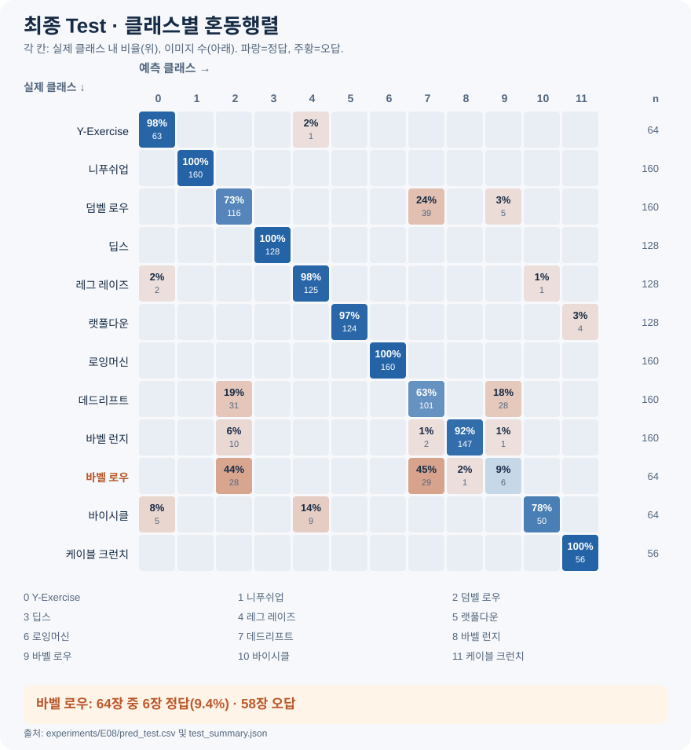

*행은 실제 클래스, 열은 예측 클래스입니다. 각 행을 정규화했으며 빈 칸은 0건입니다. 기존 [원본 결과 그림](figures/e08_test.png)도 보존합니다.*

오답이 모두 대각선 근처의 같은 묶음 칸(덤벨 로우·데드리프트·바벨 로우, 바닥 운동끼리)에 있습니다.

#### 대표 오분류 사례(개념 그림)

원본 사진은 이용 조건 때문에 저장소에 넣지 않았습니다. 대신 오분류 사진을 직접 보고 확인한 패턴을 개념 그림으로 옮겼습니다. *아래 두 그림은 AI로 만든 개념 그림이며 실제 데이터 사진이 아닙니다.*

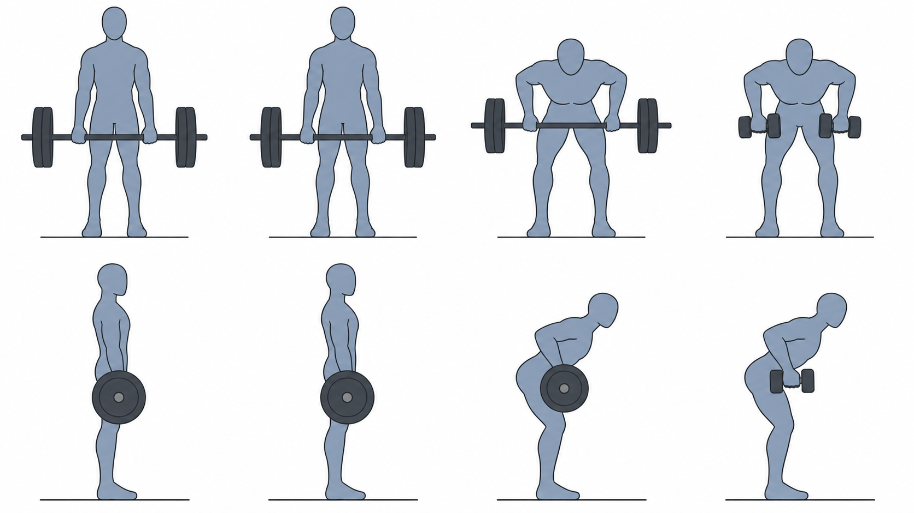

왼쪽부터 데드리프트를 다 든 자세, 바벨 로우의 선 자세, 바벨 로우의 당기는 순간, 덤벨 로우입니다. 위 줄은 정면 시점, 아래 줄은 옆 시점입니다. 앞의 두 자세는 정면에서 거의 같고, 옆에서는 상체가 완전히 펴졌는지와 바벨 위치가 보입니다. Validation 오류 분석(E06, `05_error_analysis.ipynb`)에서 데드리프트를 다 든 선 자세는 뒤·정면 카메라(A·B·C)에서 대부분 바벨 로우로 예측됐고, 옆 카메라(D·E)에서는 대부분 맞혔습니다. 바벨 로우는 옆 카메라에서 덤벨 로우(D)나 데드리프트(E)로 틀린 사진이 많았습니다. 줄인 입력에서는 바벨이 몇 픽셀 두께의 가는 선이라 바벨과 덤벨을 가르기 어렵다는 것이 그때 세운 가설입니다(세 번째·네 번째 열).

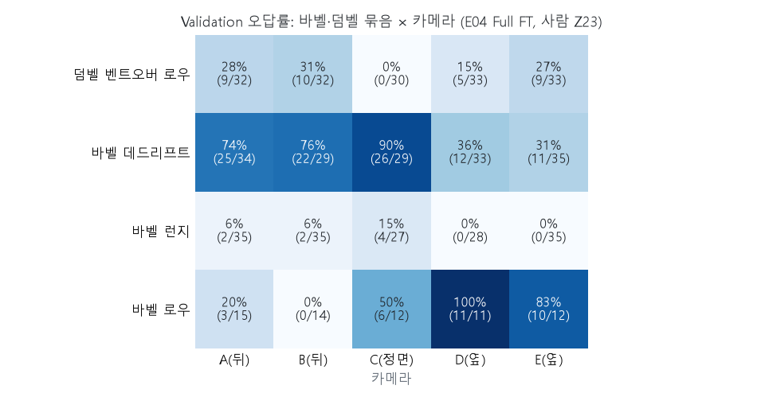

같은 패턴을 실제 Validation 예측(E04 Full FT)으로 센 결과입니다. 바벨·덤벨 묶음의 Validation은 한 사람(Z23)이라, 이 표는 그 사람의 사진에 대한 결과입니다. 데드리프트 오답률은 뒤·정면(A·B·C) 74~90%, 옆(D·E) 31~36%입니다. 바벨 로우는 옆 카메라 D·E에서 83~100%를 틀렸습니다. 카메라당 바벨 로우 사진이 11~15장뿐이라 칸별 비율은 크게 흔들릴 수 있습니다.

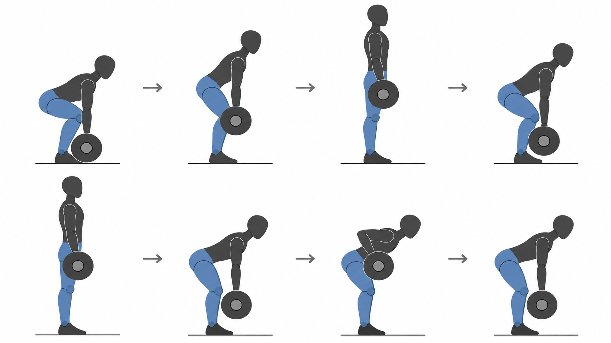

위 줄은 데드리프트, 아래 줄은 바벨 로우의 동작 흐름입니다. 데드리프트를 끝까지 든 순간(위 3번째)과 바벨 로우를 시작하기 전 선 자세(아래 1번째)는 사진 한 장으로는 거의 구분되지 않습니다. 두 운동의 차이는 어느 자세에 머무는지와 움직임 방향인데, 정지 사진에는 이것이 담기지 않습니다. 최종 Test에서는 바벨 로우 64장 중 6장만 맞혔고, 틀린 사진은 데드리프트(29장)와 덤벨 로우(28장)로 갈렸습니다. Test 사진은 들여다보지 않았으므로 Test에서 무너진 원인은 확정하지 않았습니다(`09_test_evaluation.ipynb`).

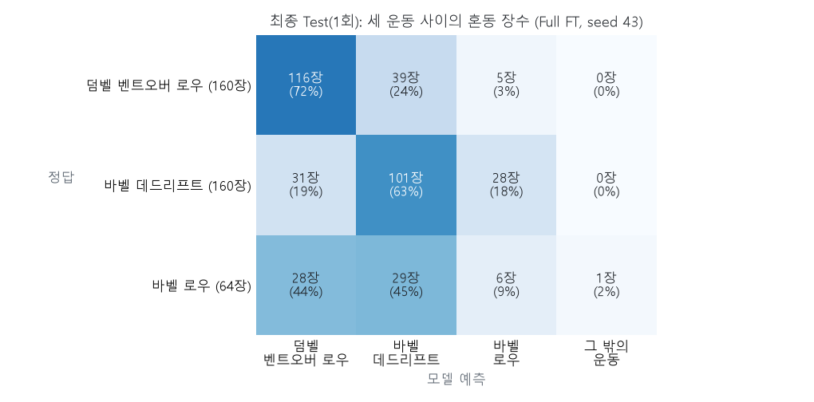

최종 Test 예측(E08, 저장된 결과)에서 세 운동만 떼어 본 표입니다. 세 운동의 오답은 1장을 빼고 모두 셋 사이에서 났습니다. 덤벨 로우와 데드리프트도 서로 24%·19%씩 섞였지만, 바벨 로우는 정답(9%)보다 덤벨 로우(44%)와 데드리프트(45%)로 간 사진이 훨씬 많았습니다.

### Test 이후 보충 실험(Test는 다시 쓰지 않음)

#### 전처리 비교: 공식 Val(P1) vs 사람 단위 CV

조건은 Full FT, 학습 설정 동일, 전처리만 바꿈입니다. CV 점수는 Early Stopping과 같은 fold 데이터로 매겨 낙관적이므로 후보 사이 비교에만 씁니다.

| 전처리 | 내용 | P1(공식 Val, seed 3) | CV 1단계(seed 42) | CV 2단계(9쌍 평균 Δ) |
|---|---|---|---|---|
| letterbox | 비율 유지 + 위아래 패딩(기준) | 기준 | 기준 | 기준 |
| stretch | 224×224로 늘려 맞춤 | 구분 불가 | 일관 개선 | **채택** +0.014(8/9) |
| aspect224 | 224×126(비율 유지, 패딩 없음) | 나쁨 | 차이 없음 | 대상 아님 |
| aspect384 | 384×216(원본 크기) | 구분 불가, 붕괴 경향 | 일관 개선 | **채택** +0.028(9/9), 학습 시간 1.43배 |
| ccrop | 가운데 216 자르기 → 224 | 좋음 | 일관 개선, 붕괴 경향 | 채택 안 함 +0.028(바벨 로우 붕괴) |
| gray | 흑백 | 나쁨 | 차이 없음 | 대상 아님 |

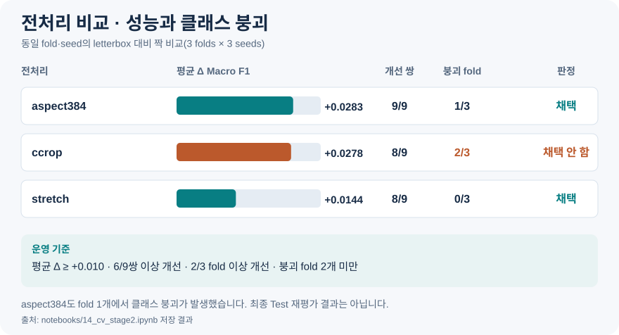

[기존 fold·seed별 상세 그림](figures/cv2_preprocessing.png)

- 같은 조건에서 seed만 바꾼 흔들림이 공식 Val 0.014에서 CV 0.008~0.011로 줄었습니다.
- 사람을 크게·자세히 보는 전처리일수록 덤벨 로우(0.67→0.83)와 데드리프트(0.68→0.85)는 오르고, 바벨 로우 오답은 데드리프트로 더 몰렸습니다(9회 합계 493→683장/1,128장).

#### VLM 기반 개선 가설(추론만, 새 학습 없음)

| 가설 | 확인 방법 | 결과 | 판정 |
|---|---|---|---|
| H1 한 순간만 담김 | 같은 클립 8장(4시점 × 시점마다 다른 카메라 2대) 확률 평균 | +0.047(3/3 fold). 2장으로 맞추면 다른 각도 +0.009~0.013, 다른 순간 +0.011~0.017 | 지지(8장 결합). 각도·순간 차이 구분 불가, 사진 수와 다양성 효과 미분리 |
| H2 사람이 작음 | ccrop | 평균은 오르나 바벨 로우 붕괴 | 채택 실패(같은 방향의 aspect384는 채택) |
| H3 색 단서 | 컬러 모델에 흑백 입력 / 흑백으로 학습 | 흑백 학습 모델 0.846 vs 컬러 0.845 | 부분 지지(규칙). 색은 필요조건 아님 |

- 클립 평균은 "사진 한 장" 과제를 바꾸는 방식이라 기본 결과와 섞지 않고 응용 방식으로만 보고합니다.

#### 진단 분석(추론만)

- **사람별 성능:** 사람 사이 흩어짐(sd 0.13~0.15)이 같은 사람의 seed 사이 흩어짐(0.014~0.025)보다 6~10배 큽니다. 점수 0.80 미만인 6명은 모두 바벨·덤벨 묶음 사람입니다(묶음 평균 0.65, 기구 0.99).
- **묶음 안/밖 오류:** 오답의 99.7% 이상이 같은 묶음 안에서 납니다. 공식 Val에서는 Scratch·Transfer 모두 100%입니다.
- **클립 일관성:** 바벨 로우는 클립의 30%를 8장 모두 틀립니다. 그래서 클립 평균으로도 풀리지 않습니다. 바벨·덤벨 묶음에서는 같은 순간을 다른 카메라로 본 2장의 예측이 더 자주 달라서, 예측이 찍은 각도에 크게 좌우됩니다.
- Grad-CAM(9장, 정성): Transfer 모델은 주로 사람 몸통을, Scratch 모델은 사람 옆 바닥·배경을 자주 봤습니다. 묶음마다 촬영 공간이 다르다는 EDA와 함께 보면, Scratch가 배경에 기대는 경향이 있다는 가설과 맞습니다(확정 아님).

#### 학습 데이터 양(25/50/100%, 사람 단위 CV)

공식 도전 과제 "학습 데이터 25/50/100% 비교"를 사람 단위 3-fold CV로 했습니다. 학습 데이터만 줄이고 검증 사람의 데이터는 항상 100%입니다(letterbox 224, 증강 없음, seed 42).

| 전략 | 25% | 50% | 100% | 100%→25% 손실 |
|---|---|---|---|---|
| Scratch | 0.685 | 0.729 | 0.753 | 0.068 |
| FE | 0.723 | 0.729 | 0.748 | 0.025 |
| Full FT | 0.828 | 0.839 | 0.845 | 0.017 |

(fold 3개 평균 Macro F1, 학습 사진은 fold마다 약 1,600 / 3,200 / 6,400장)

- **"데이터가 적을수록 Transfer 이점이 커진다"는 미리 정한 기준으로 구분 불가**입니다. 평균 이점(Full − Scratch)은 0.143 → 0.111 → 0.091로 줄었지만, fold 1에서는 방향이 반대였습니다(−0.010). 평균만 봤다면 "지지"라고 썼을 결과입니다.
- **Full FT는 학습 사진 1/4로도 Scratch 100%보다 높았습니다**(세 fold 모두). 사전학습의 가치가 "적은 데이터로 버티는 능력"으로 가장 분명히 드러났습니다.
- FE는 25%에서 Scratch보다 높은 fold가 2/3, 100%에서는 1/3이었습니다. 데이터가 적으면 FE와 Scratch의 순서가 뒤집히는 경향입니다.
- 데이터를 줄이면 무너지는 곳은 바벨·덤벨 묶음입니다(Scratch 데드리프트 Recall 0.58 → 0.36). 바벨 로우는 어떤 조건에서도 0.31을 넘지 못했습니다.

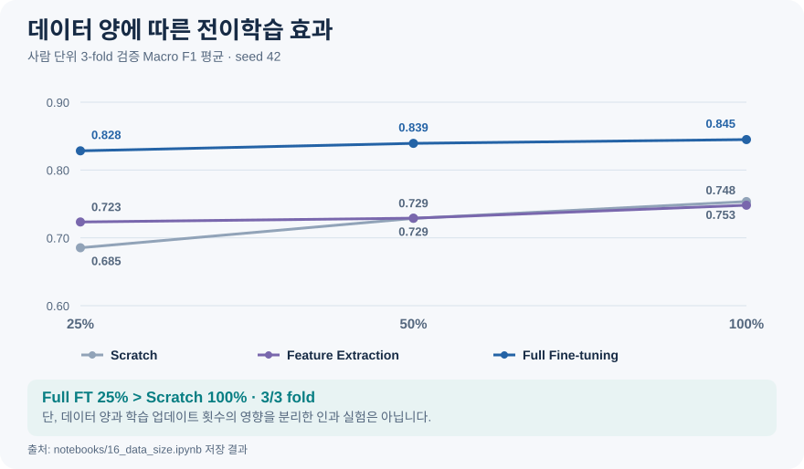

[기존 fold별 범위 및 전략 차이 그림](figures/ds_data_size.png)

## 7. 한계 및 배운 점

- **한계**
  - Val도 Test도 **운동마다 한 사람**입니다. 클래스 점수가 사실상 그 한 사람의 점수라, 사람에 따른 흔들림을 잴 수 없었습니다. 선정에 쓴 Val 점수가 Test보다 0.04 낙관적이었습니다.
  - 정지 사진 한 장으로는 데드리프트의 선 자세와 로우를 가르기 어려운 프레임이 있습니다. 바벨 로우는 모든 전처리에서 가장 약했습니다.
  - **Test를 일찍 썼습니다.** 사람 단위 CV를 Test 평가 뒤에 도입해서, CV에서 채택된 전처리(aspect384, stretch)로 다시 학습한 모델은 Test로 확인하지 않았습니다. E08 이후 모델은 CV로만 검증했고, 공식 결과는 E08입니다.
  - CV의 fold·seed 9쌍은 독립 표본이 아니어서(학습 데이터가 겹치고 같은 사람을 검증) 통계적 유의성을 주장하지 않습니다. 사람별 성능 차이에는 운동 묶음과 학습 fold의 차이도 포함되며, 데이터 양 비교에는 업데이트 횟수 차이도 포함됩니다.
  - VLM 분석은 오답 중심으로 선정한 55장, Grad-CAM은 9장으로 표본이 작습니다. 전체 VLM 정확도나 원인을 확정하지 않고 가설로만 썼습니다. API 비용 제한은 추정치 기반이며 실제 청구 상한은 제공자 측 설정이 필요합니다. 원본 사진을 외부 API로 보내기 전 데이터 이용 조건과 허용 여부를 확인해야 합니다.
  - 추론 배치 크기에 따라 fp16 계산이 달라져, 확률이 0.5 아래인 애매한 사진이 실행마다 0~1장 다르게 예측될 수 있습니다. 보충 분석은 학습 때 평가와 같은 배치(32)로 맞췄고, E08 Test(배치 64)는 다시 돌리지 않았습니다.
- **배운 점**
  - 0.01 차이는 seed만 바꿔도 생깁니다. 비교하기 전에 같은 조건의 흔들림부터 재야 합니다.
  - 판정 기준을 실행 전에 적어 두니, "좋아 보이는" 결과를 채택하고 싶은 유혹을 막을 수 있었습니다.
  - Accuracy와 Macro F1이 반대로 움직이는 경우가 있습니다(384: Accuracy 0.919로 최고였지만 바벨 로우 붕괴).
  - 검증하는 사람이 적으면 결론이 그 사람에게 맞춰집니다. 사람 단위 교차검증은 Test를 쓰기 전에 도입했어야 했습니다.
  - 평균 점수와 함께 "클래스가 무너지지 않는가"를 미리 기준으로 두니, 평균만 좋은 후보(ccrop)를 걸러 낼 수 있었습니다.
  - 평균과 함께 fold별 방향을 기준에 넣어 두니, 평균 차이가 커도 한 fold가 반대인 결과(데이터 양 실험)를 "구분 불가"로 정직하게 적을 수 있었습니다.
- **다음 접근:** 처음 보는 사람으로 된 외부 Test로 E08과 CV 채택 전처리를 함께 비교하기, 옆 카메라 시점을 함께 쓰는 입력(다중 시점), 바벨 로우처럼 적고 경계가 불안정한 클래스의 데이터 늘리기.
